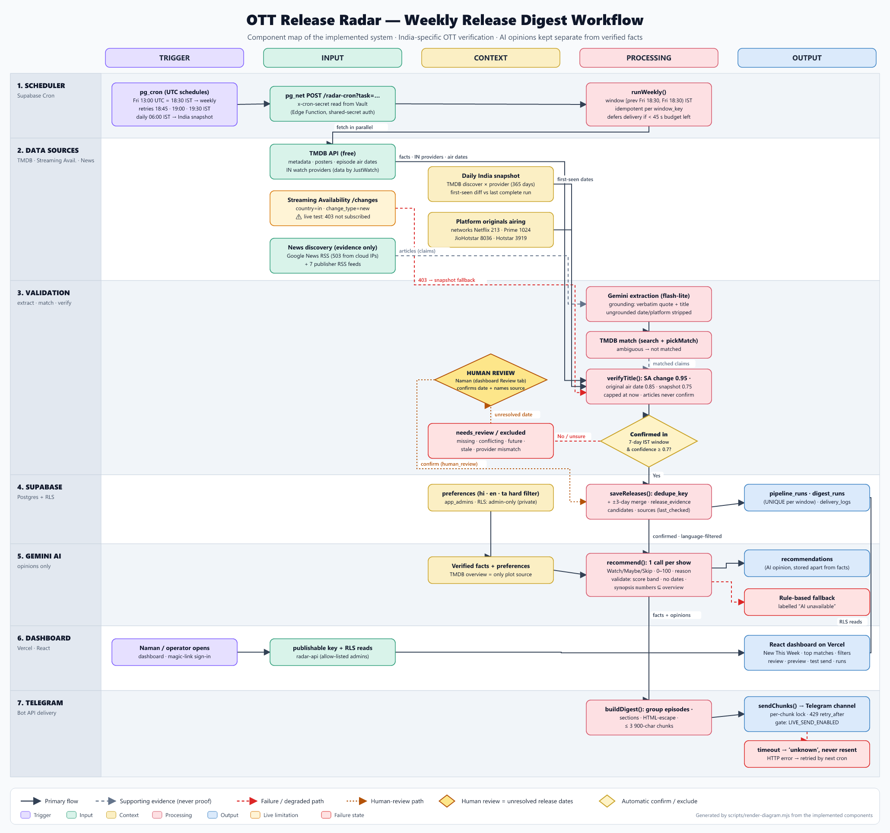

# Release Radar — India OTT "New This Week"

A personalised dashboard and Friday Telegram digest of **verified** new releases on **Netflix, Prime Video and JioHotstar in India**. It's built for one viewer (Naman: Thriller, Sci-Fi, Indie Drama; Hindi, English, Tamil).

- **Dashboard (private to Naman — magic-link sign-in, allow-listed emails only):** https://ott-release-radar-six.vercel.app
- **Digest:** every Friday 18:30 IST via Telegram. Scheduled sends are **off** (`LIVE_SEND_ENABLED=false`) until the owner approves.
- **Docs:** [component map](docs/component-map.md) · [nine checks](docs/nine-checks.md) · [source feasibility](docs/feasibility.md)

> Facts and AI opinions are kept apart. Availability, dates, languages and plot come only from verified sources (TMDB/JustWatch, Streaming Availability, our India snapshot diff, or a human review). Gemini only adds a labelled Watch/Maybe/Skip opinion. News articles are used to discover titles and **never** confirm a release.

## Architecture



| Layer | What | Where |
|---|---|---|
| Scheduler | Supabase Cron (`pg_cron` + `pg_net`) → `radar-cron` Edge Function, shared secret from Vault | `supabase/migrations/*_cron.sql` |
| Pipeline | snapshot · collect (fetch → normalise → dedupe → verify) · recommend · digest · deliver | `supabase/functions/_shared/*.ts` |
| Verification | rules + confidence thresholds, window capped at "now" | `_shared/verify.ts` |
| AI | Gemini (server-side) for article extraction + opinions, with strict validation and rule-based fallback | `_shared/gemini.ts` |
| Data | Postgres with RLS; facts / evidence / opinions / runs / deliveries in separate tables | `supabase/migrations/*` |
| Dashboard | React + Vite on Vercel, **private**: every table is RLS-restricted to allow-listed admins (anon gets 401); admin actions via `radar-api` | `web/` |
| Delivery | Telegram Bot API, HTML, ≤ 3 900-char chunks, per-chunk idempotency | `_shared/telegram.ts` |

### Schedule (UTC; IST = UTC+05:30)

| Job | Cron | IST |
|---|---|---|
| `radar-snapshot-daily` | `30 0 * * *` | daily 06:00 |
| `radar-snapshot-prefriday` | `45 12 * * 5` | Fri 18:15 |
| `radar-weekly` | `0 13 * * 5` | **Fri 18:30** |
| `radar-weekly-retry-1/2/3` | `15 13`, `30 13`, `0 14` (Fri) | 18:45, 19:00, 19:30 |

### Duplicate-send protection

1. **One digest per week.** `digest_runs` has a unique index on `window_key` (the window's Friday). Retries and manual reruns reuse that week's digest.
2. **Per-chunk lock.** `delivery_logs` is unique on (digest, chunk, chat). A chunk marked `sent` is never resent.
3. **Uncertain sends stop.** A network timeout marks the chunk `unknown` and the digest `needs_attention`. It is never resent automatically, because Telegram may already have delivered it.
4. **Manual actions can't send the weekly digest.** Manual "re-run collection" and "snapshot" never send. "Test send" posts a message labelled TEST, requires typing `SEND TEST`, and is throttled to one per 2 minutes.
5. **Late triggers are refused.** `runWeekly` refuses windows more than 3 h old, so a mid-week trigger can't send last week's digest late.

## Run locally

Requirements: Node ≥ 20.12 (developed on 24), npm. No Docker needed.

```bash
npm install
```
```bash
npm test
```
```bash
npm run typecheck:functions
```
```bash
cp web/.env.example web/.env.local
```
```bash
npm --prefix web install
```
```bash
npm run web:dev
```
Open http://localhost:5173. Add `?fixtures=1` to see **development fixtures**. They are fictional and shown under a warning banner.

## Tests

- `npm test` runs the Vitest unit tests with mocked HTTP. They cover:
  - IST window boundaries and timezone conversion
  - duplicates and merging
  - conflicting, missing, future and stale article dates
  - provider mismatch and episode grouping
  - bad, partial and retired-model Gemini output
  - 429/5xx retries
  - Telegram failures, timeouts and duplicate prevention
  - RSS/TMDB/Streaming Availability parsing
  - the language hard filter
- **Mocks are not live verification.** For live checks:
  - `node scripts/feasibility.mjs`: read-only source probe.
  - `node --experimental-transform-types scripts/live-smoke.mjs collect|preview`: runs the real pipeline against live services with per-host timings. It never calls Telegram.
  - `node scripts/ops.mjs call preview --wait`: builds the deployed function's digest without sending.

## Deploy

All CLIs are used via `npx`. Log in first: `npx supabase login`, `npx vercel login`, `gh auth login`.

1. **Database:**
   ```bash
   npx supabase link --project-ref <ref>
   ```
   ```bash
   npx supabase db push --linked
   ```
   Then check with `npx supabase db advisors --linked` (expected: no findings).
2. **Secrets:** fill `.env` from `.env.example`, then run the command below. It pushes Edge secrets without printing them and generates `CRON_SECRET`.
   ```bash
   node scripts/sync-secrets.mjs
   ```
3. **Functions** (`--use-api` means no Docker is needed):
   ```bash
   npx supabase functions deploy radar-cron radar-api --use-api
   ```
4. **Scheduler:** store the functions URL and the cron secret in Vault:
   ```bash
   node scripts/ops.mjs configure-scheduler
   ```
5. **First snapshot** (baseline; it cannot date anything):
   ```bash
   node scripts/ops.mjs call snapshot --wait
   ```
6. **Dashboard:** run `npx vercel link` in `web/`, add `VITE_SUPABASE_URL` and `VITE_SUPABASE_PUBLISHABLE_KEY` to Vercel production env, then:
   ```bash
   npx vercel deploy --prod
   ```
   Set Supabase Auth `site_url` and redirect URLs to the Vercel URL; this repo uses `supabase config push`.
7. **Admins:**
   ```bash
   node scripts/ops.mjs add-admin naman@example.com owner
   ```
8. **Go live** (owner approval required): set `LIVE_SEND_ENABLED=true` in `.env`, then run `node scripts/sync-secrets.mjs`.

## Credentials (minimum)

| Variable | Where it lives | Why |
|---|---|---|
| `SUPABASE_URL`, `SUPABASE_PUBLISHABLE_KEY` | browser + server | public API endpoint; RLS allows reads only to allow-listed admins |
| `SUPABASE_SECRET_KEY` | server only (`RADAR_SECRET_KEY` Edge secret, local ops) | pipeline writes |
| `TMDB_READ_TOKEN` | Edge secret | metadata, posters, India providers |
| `RAPIDAPI_KEY` | Edge secret | Streaming Availability (needs free plan subscription) |
| `GEMINI_API_KEY` (+ fallback) | Edge secret | extraction + opinions |
| `TELEGRAM_BOT_TOKEN`, `TELEGRAM_CHAT_ID` | Edge secret | delivery |
| `CRON_SECRET` | Edge secret + Vault | authenticates pg_cron → function |

The repository needs no GitHub token. `.env`, `web/.env.local` and `.vercel/` are gitignored.

## Attribution

This product uses the TMDB API but is not endorsed or certified by TMDB. Watch-provider data is by JustWatch, via TMDB. Release Radar is independent and not affiliated with Netflix, Amazon or JioStar.
